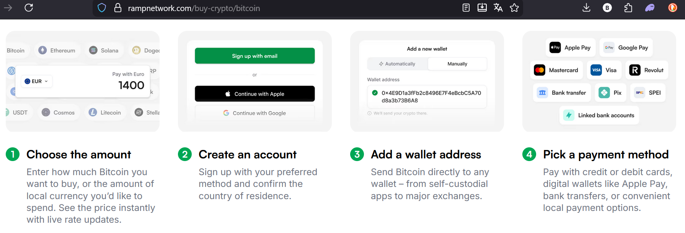
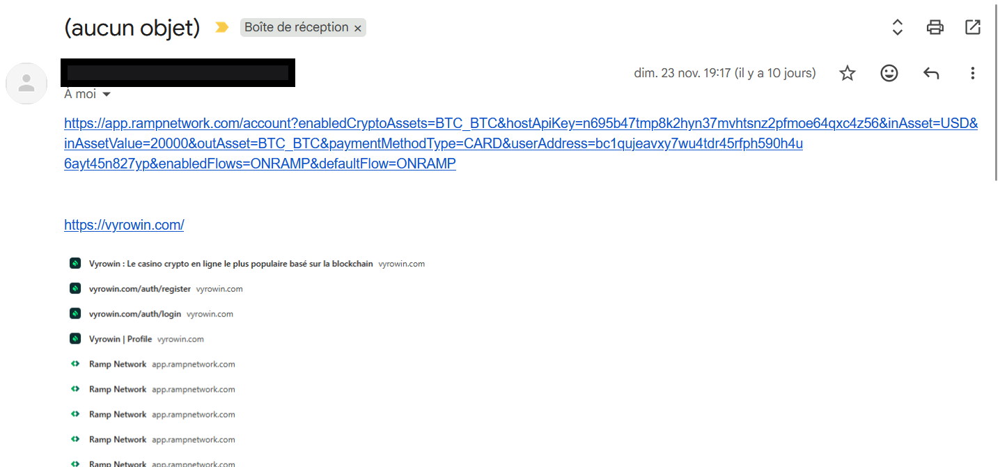
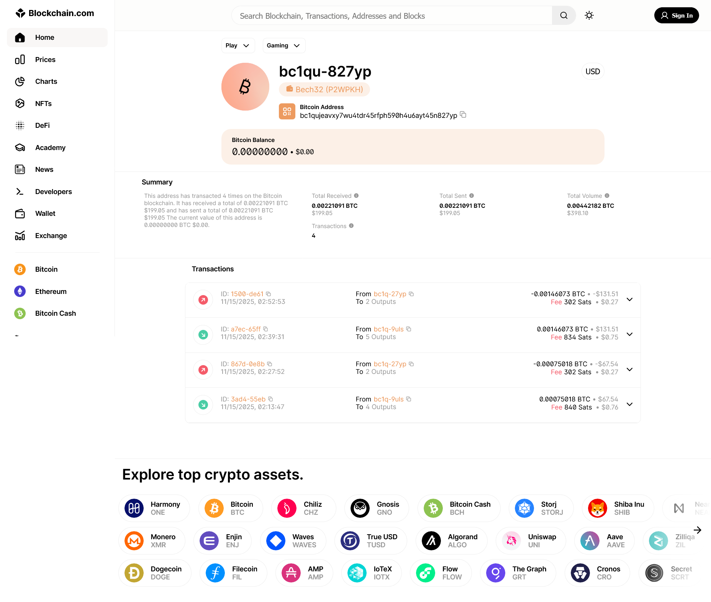
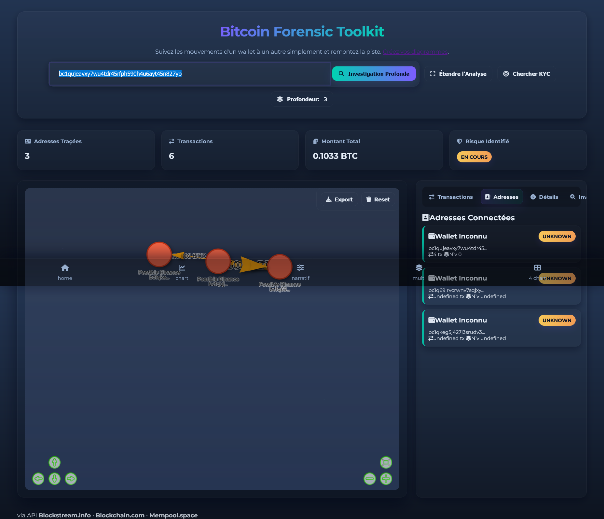
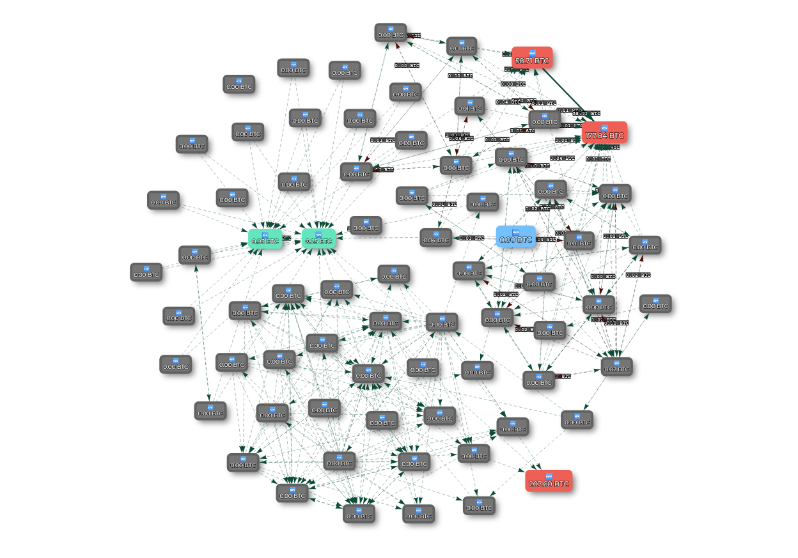
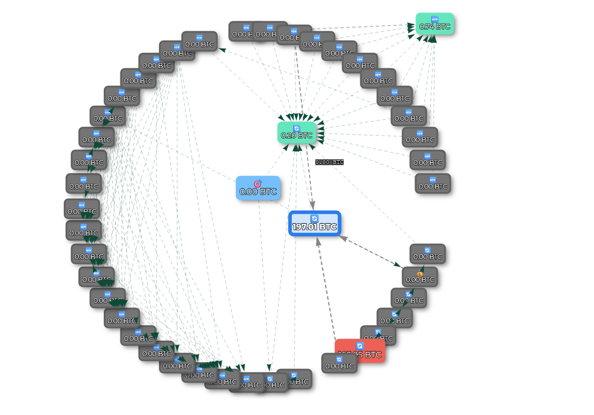
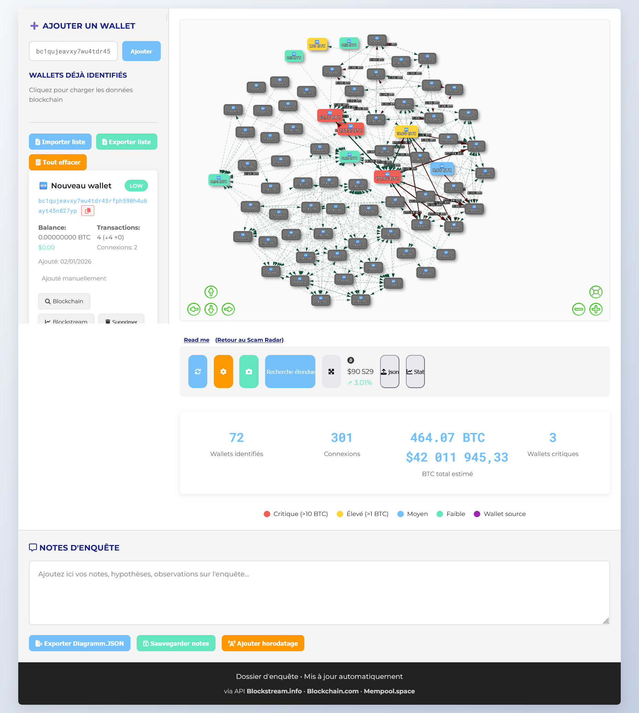

# **Traque sur la Blockchain : Comment je suis la piste de 200€ volés**

*Une promesse de rendement mirobolant, 200€ envoyés sur un site et une trace numérique indélébile. Voici le récit d'une enquête pour retrouver un arnaqueur dans les nébuleuse de la blockchain.*

---

### **Une Arnaque Classique**

Tout a commencé par une confidence. Le fils d'une amie m'a avoué s'être fait avoir. Comme des milliers de personnes chaque jour, il a cru à une promesse d'investissement trop belle pour être vraie. Le schéma était simple : on lui a envoyé un lien, il a rentré ses coordonnées de carte et 200€ ont disparu vers un destinataire inconnu.

Dans le monde réel, l'histoire s'arrête souvent là. L'argent est parti, introuvable. Mais cette fois, l'arnaqueur a utilisé Bitcoin. 

### **La Piste Numérique : L'URL Piégée**

L'arnaqueur a fourni à sa victime un lien d'un service parfaitement légal, [Ramp Network](https://rampnetwork.com/), une plateforme qui permet d'acheter des cryptomonnaies.

Voici ce lien, que nous allons décortiquer :
`https://app.rampnetwork.com/account?enabledCryptoAssets=BTC_BTC&hostApiKey=n695b47tmp8k2hyn37mvhtsnz2pfmoe64qxc4z56&inAsset=USD&inAssetValue=20000&outAsset=BTC_BTC&paymentMethodType=CARD&userAddress=bc1qujeavxy7wu4tdr45rfph590h4u6ayt45n827yp&enabledFlows=ONRAMP&defaultFlow=ONRAMP`

Entrons dans le vif du sujet. Dans l'url envoyé par l'arnaqueur, on remarque deux chose, l'adresse bitcoin pour recevoir les fonds et une clef API.

*   **`bitcoinAddress=`** : C'est **l'adresse du portefeuille Bitcoin de l'arnaqueur**. C'est l'équivalent d'un **numéro de compte bancaire**, mais en public. C'est notre point de départ.
*   **`hostApiKey=...`** : C'est une **clé secrète** qui permet probablement d'automatiser le transfert des fonds volés vers d'autres comptes pour brouiller les pistes.

**La grande différence avec un virement bancaire ?**  
Quand vous envoyez des Bitcoin à une adresse, cette transaction est écrite dans un grand **registre public et infalsifiable** : la blockchain. C'est comme si, à chaque virement, vous publiez un reçu indélébile que tout le monde peut consulter. C'est à la fois un outil de transparence... et une aubaine pour les enquêteurs.

[Suivre l'enquete en temps réel](https://crypto-free-tools.netlify.app/scam-radar/enquete/)

---

### **Prochaine étape : La "Cartographie"**

> **"Première étape : Suivre l'argent à la trace."**
> 
> Depuis le portefeuille de l'arnaqueur (`bc1q...`), j'ai utilisé des outils d'exploration pour regarder dans le registre public : **"À qui a-t-il envoyé l'argent ? "**
> 
> C'est comme si, en découvrant le compte bancaire d'un receleur, on pouvait instantanément voir la liste de tous ses virements entrants et sortants. Cette première étape a fait apparaître **3 autres portefeuilles** liés.

### Liste des outils d'exploration utilisé :

*   [blockchain.com](https://www.blockchain.com/explorer)
*   [blockstream.info](https://blockstream.info/)
*   [Mempool.space](https://mempool.space/)

Puis création d'un outil pour visualiser les liens entre les wallet, via les api des site ci dessus.
*   [Outil Scam Radar (fait maison)](https://crypto-free-tools.netlify.app/scam-radar/)
Et enfin l'outils sur mesure pour cette enquete. 
*   [Enquete ](https://crypto-free-tools.netlify.app/scam-radar/enquete/)
---

### 🗺️ La Cartographie : Suivre l'Argent à la Trace

Avec l'adresse Bitcoin de l'arnaqueur (`bc1q...`), on peut visualiser toute les transactions depuis sa création. Pour ça on utilise les outils d'exploration blockchain légitime tel que
[blockchain.com](https://www.blockchain.com/explorer/addresses/btc/bc1qujeavxy7wu4tdr45rfph590h4u6ayt45n827yp), [blockstream.info](https://blockstream.info/) et [mempool.space](https://mempool.space/).

Mais visuellement j'aimerais une map, ça serais plus concret ... plus "palpable".

Alors je code un premier tool pour créer une map avec threejs et d'autre lib, puis m'aide de l'ia pour gérer les algo complexe, fetch à l'api etc.
Et voila on VOIS enfin les liens entre les wallet de cette arnaque. 

Résultat immédiat : 3 autres portefeuilles (*wallets*) sont reliés par des transactions entrante et sortante. On suit un premier virement de la petite arnaque, les 200€ sont divisé et envoyé à deux wallet. Notre wallet source n'as effectué que ces deux ordre pour le moment. Certainement un wallet créé pour une arnaque, vidé, puis abandonné. One shot.

Ok là c'est mieux mais il faudrait pouvoir, visuellement, conserver notre map et étendre la recherche de transactions sur les nouveaux wallet entrant. On code ça avec deepseek.

### 💰 Le Schéma du "Mixer" : Le blanchiment

En suivant les flux, un schéma très clair apparaît. L'argent suit un chemin précis, comme dans un lave-linge à fric (*mixer*) :

1.  **Les Wallets "One-Shot" (Gris)** : Ils reçoivent l'argent directement des victimes, par petits paquets. Un par arnaque.
2.  **Les Wallets Intermédiaires (Verts)** : Ils servent d'entonnoir. Les petits paquets de plusieurs arnaques y sont rassemblés.
3.  **Les Wallets de Concentration (Rouges)** : C'est la sortie du mixer ou le coeur de la nébuleuse. Les sommes importantes y sont centralisées.

 

En suivant cette piste, j'ai identifié 50 wallets clés dans la chaîne. Deux sortent du lot :

*   **Wallet** (`bc1qns9f7yfx3ry9lj6yz7c9er0vwa0ye2eklpzqfw`) : Il concentre déjà **27 BTC** (plus de 2 millions d'euros) et est connecté à 26 autres wallets.
*   **Wallet** (`bc1q9wvygkq7h9xgcp59mc6ghzczrqlgrj9k3ey9tz`) : La cagnotte principale. **267 BTC**. Plus de 21 millions d'euros. Connecté à plus de 50 wallets.

### 🎯 L'Objectif : Trouver le Maillon Faible (le KYC)

L'argent est là, sur la blockchain, publique. Mais les adresses Bitcoin sont pseudonymes. Comment remonter à une personne ?

La faille, c'est le **KYC** (*Know Your Customer*). Quand tu veux convertir tes cryptos en euros sur une plateforme légitime (un *exchange* comme Binance, Coinbase, etc.), tu dois fournir ta carte d'identité. C'est la loi.

**Mon objectif depuis le 03/12/2025 :** trouver, parmi les 8 wallets principaux ou les 400+ wallets reliés, celui qui a un jour interagi avec un service qui demande un KYC. Ce serait le jackpot : une adresse contrôlée par une personne identifiée.

### la Piste Chaude (01/01/26)

Pour aller plus loin, j'ai poussé mon outil Scam Radar V2 avec de nouvelles features comme `deep_transaction_fetch.js` et `mixer_analysis.js`. Le but ? Détecter la moindre transaction cachée, le moindre wallet qui se planque dans le flot, sans avoir à passer 2 heures par adresse à tout vérifier manuellement.

Et ça a payé. L'analyse renforce une piste énorme : le **Wallet** (`bc1qns9f7yfx3ry9lj6yz7c9er0vwa0ye2eklpzqfw`), aujourd'hui avec 207 BTC, présente **tous les signes d'un wallet appartenant à un exchange**.

| Indicateur | Wallet n°8 (Observé) | Wallet Normal |
| :--- | :--- | :--- |
| **Activité** | **24/7**, sans pause | Heures locales |
| **Transactions** | **Massives**, en batch | Quelques-unes, variables |
| **Contreparties** | **Des centaines/ milliers** | Quelques dizaines |

**Impression :** Il s'agit d'un mixer que certainement, beaucoup de voleur utilise.  

Des sites comme [BitcoinWhosWho](https://www.bitcoinwhoswho.com/address/bc1q9wvygkq7h9xgcp59mc6ghzczrqlgrj9k3ey9tz) et l'explorer [Blockchain.com](https://www.blockchain.com/explorer/addresses/btc/bc1q9wvygkq7h9xgcp59mc6ghzczrqlgrj9k3ey9tz) commencent aussi à taguer cette adresse comme suspecte.

### ⚖️ La Suite : Passer aux Autorités

J'ai demandé à une IA (Deepseek) de structurer un dossier pour les autorités. Son verdict : mon analyse technique est **solide et nécessaire**, mais pas suffisante pour déposer plainte. Il faut l'associer au **parcours de la victime**.

**Les Preuves Techniques (ce que j'ai apporté) :**
*   La preuve d'une intention de blanchiment (schéma *one-shot* > *mixer*).
*   La cartographie complète de la fuite des fonds.
*   La preuve matérielle (l'URL frauduleuse avec la clé API).

**Les Éléments Manquants CRUCIAUX pour une plainte :**
*   **L'identité et le récit détaillé de la victime** (déposition écrite, pièce d'identité).
*   **Les preuves du virement** (relevés bancaires, emails de confirmation de Ramp Network).
*   **L'intégralité des conversations** avec l'arnaqueur (captures d'écran).

**La marche à suivre est claire :**
1.  **Déposer plainte immédiatement** à la gendarmerie/police avec tous les éléments ci-dessus.
2.  **Signaler à Ramp Network** l'adresse frauduleuse (`bc1quje...`) et la clé API utilisée. Ils peuvent peut-être geler des fonds ou identifier un compte.
3.  **Suivre la piste du Wallet 8** auprès des autorités, qui pourront requérir l'identité auprès de l'exchange suspecté.

Mon travail d'enquête montre **où est l'argent** et **comment il a été caché**. Le travail avec les autorités et la victime permettra, peut être, d' **identifier l'arnaqueur**.

Merci d'avoir suivie cette enquête, en ésperant qu'elle vous donne envie 
**Tous les outils et rapports de cette enquête sont publics :**
*   **[Outil Scam Radar V2](https://crypto-free-tools.netlify.app/scam-radar/enquete/)** : Pour cartographier toi-même des adresses suspectes.
*   **[Rapports JSON complets](./rapport/)** : Les données brutes de l'analyse.
*   **[Dossier GitHub complet](https://github.com/berru-g/enquete)** : Avec l'historique, les images et le code.

La traque continue. La blockchain n'oublie rien.