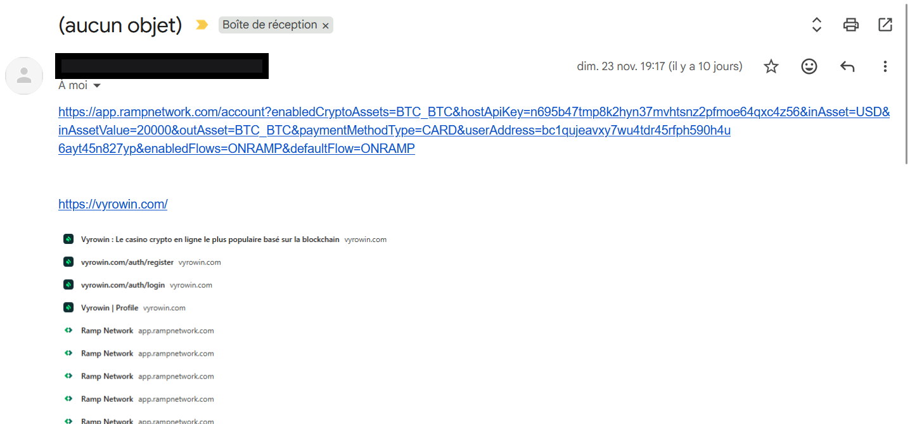
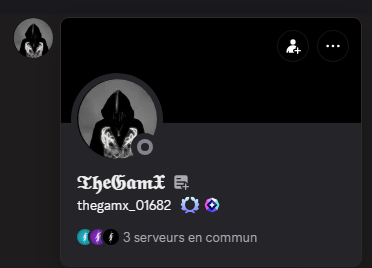
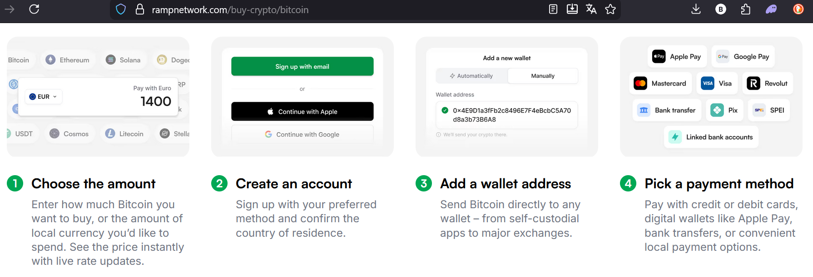
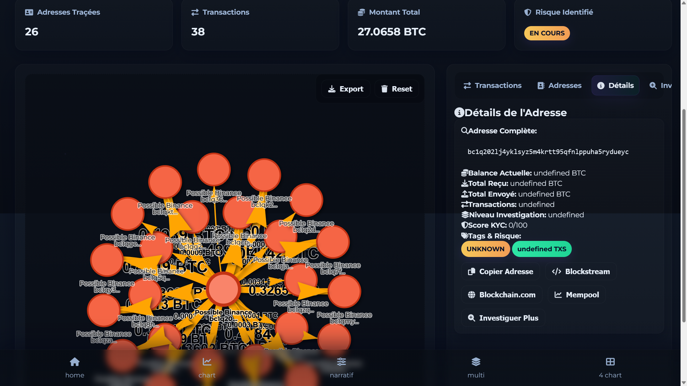
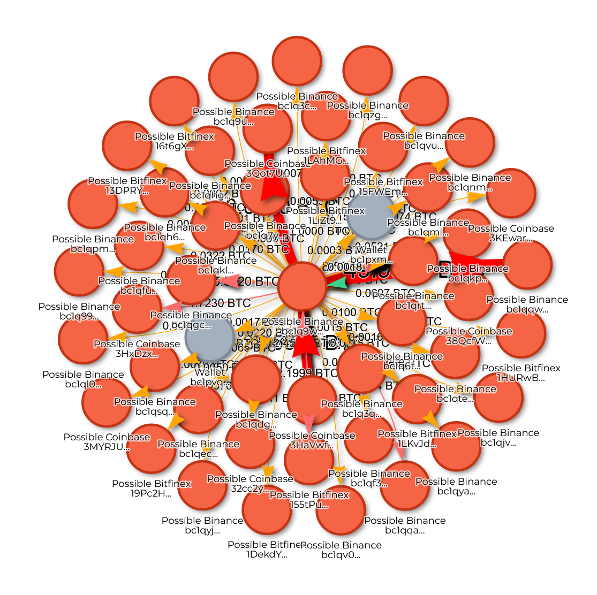
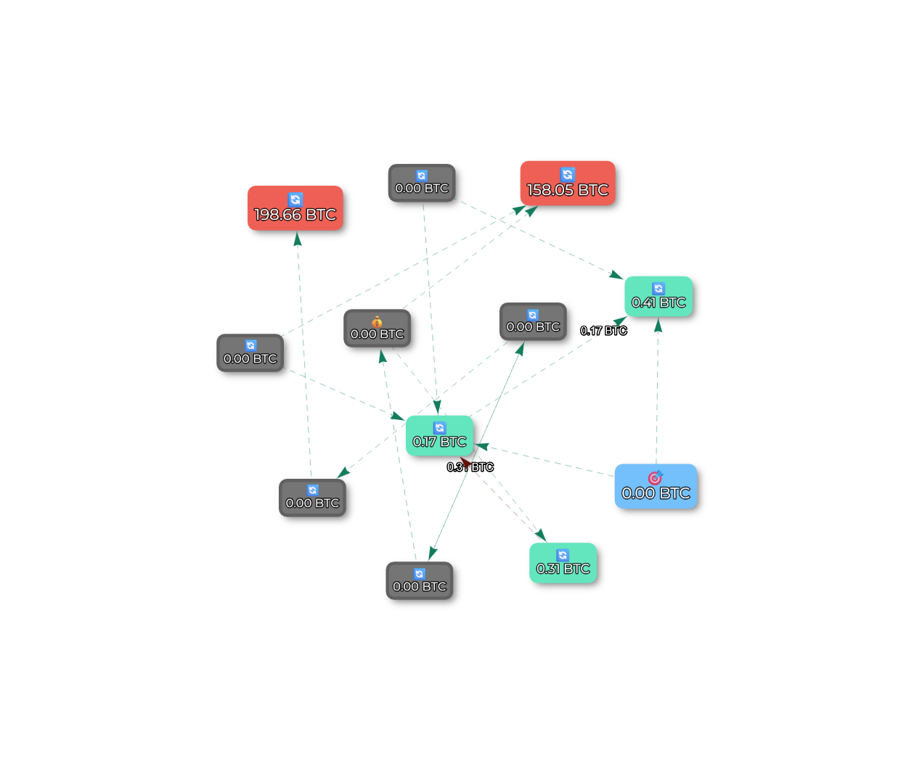
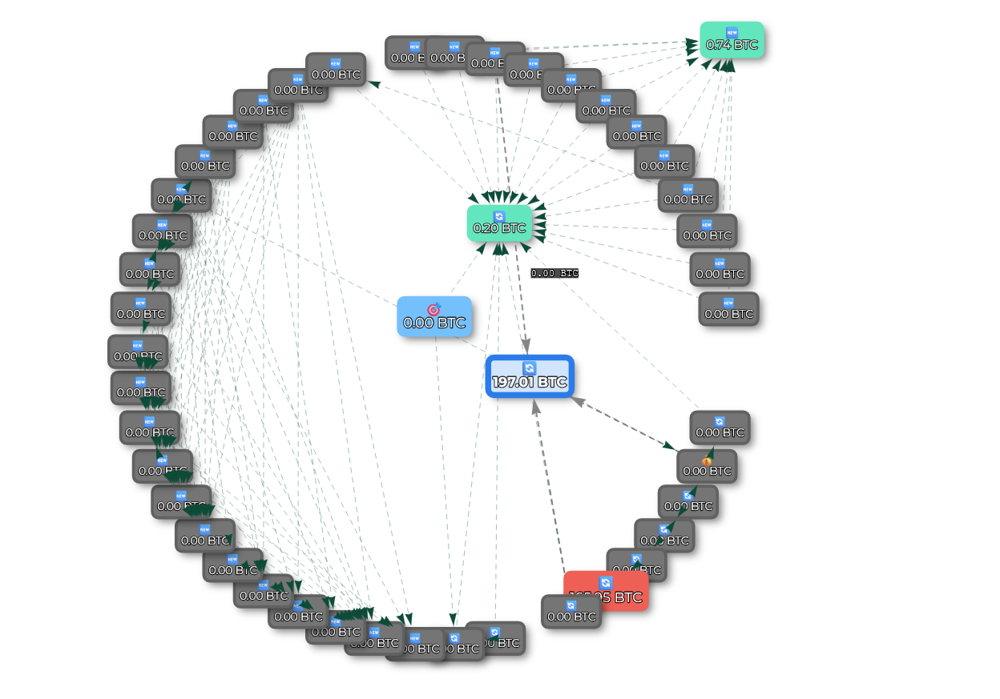

# Analysis of an Investment Scam

It all starts when my boss's son tells me he got scammed (the reality is that he was promised a return on investment and this piece of s*** sent €200).

The facts:

This is a scam based on an investment promise, where the victim is prompted to send funds through a fraudulent URL.

[Follow the investigation in real time](https://crypto-free-tools.netlify.app/scam-radar/enquete/)

## Investigation Process

1.  **Identify** all wallets connected by incoming or outgoing transactions.
2.  **Map** the financial flows with a diagram.
3.  **Search** for a KYC-verified wallet to identify the scammer's ID.

## Tools Used

*   [blockchain.com](https://www.blockchain.com/explorer)
*   [blockstream.info](https://blockstream.info/)
*   [Mempool.space](https://mempool.space/)
*   [Scam Radar tool (homemade)](https://crypto-free-tools.netlify.app/scam-radar/)
*   [Scam Radar V2 investigation tool](https://crypto-free-tools.netlify.app/scam-radar/enquete/)

---

## Analysis of the URL Provided to the Victim

The scammer provided the following URL:
`https://app.rampnetwork.com/account?enabledCryptoAssets=BTC_BTC&hostApiKey=n695b47tmp8k2hyn37mvhtsnz2pfmoe64qxc4z56&inAsset=USD&inAssetValue=20000&outAsset=BTC_BTC&paymentMethodType=CARD&userAddress=bc1qujeavxy7wu4tdr45rfph590h4u6ayt45n827yp&enabledFlows=ONRAMP&defaultFlow=ONRAMP`

### Elements identified in the URL

*   **Recipient Bitcoin address** : `bc1qujeavxy7wu4tdr45rfph590h4u6ayt45n827yp`
*   **API key** : `n695b47tmp8k2hyn37mvhtsnz2pfmoe64qxc4z56`

### Screenshots provided by the victim

### First deduction

The API key probably serves to automate the transfer of funds from one wallet to several others, splitting the amounts to cover the tracks.

The purchase of Bitcoins in euros is done via [Ramp Network](https://rampnetwork.com/), a legitimate platform that makes it easy to buy cryptocurrency by card and send it to an external wallet. The scammer hijacked this process by asking the victim to use the platform to buy BTC and send it to his wallet.

---

## Transaction Traceability

### Starting point of the investigation

The analysis starts from the target address: `bc1qujeavxy7wu4tdr45rfph590h4u6ayt45n827yp`.

*   **Initial result**: 3 wallets are connected through incoming or outgoing transactions.
    *   [See the details (JSON)](../json/bitcoin-investigation-step1.json)

> **Important note**: The original wallet only received the amount of the scam. That amount was then split and sent to another wallet (`bc1q69lrvcrwnv7sqjxyuq2rtu7e5st8z39kphfhsj`). We can deduce that a wallet is created for each scam and used only once (*one shot use*).

### Following the main flows

List of wallets identified in the scammer's chain, by propagation volume:

1.  `bc1qujeavxy7wu4tdr45rfph590h4u6ayt45n827yp` (source address)
2.  `bc1q69lrvcrwnv7sqjxyuq2rtu7e5st8z39kphfhsj`
3.  `bc1qzjv5s09zuepsaj808jlxcjcvhw7nprr9kytwej`
4.  `bc1q202lj4yklsyz5m4krtt95qfnlppuha5rydueyc` → **27 BTC**; 26 connected wallets.
    *   [See the details (JSON)](../json/bitcoin-investigation-step4.json)
5.  `bc1qy3896n4zy8jh62scnag6482e4khep0xsr3hn8w`
6.  `1B5hVExEx5DjAMueQGESP2b6jzBu5UfTkP`
7.  `3HaVwfq3hYxVaqZUSEJnUajYe6iyDydfz2`
8.  `bc1q9wvygkq7h9xgcp59mc6ghzczrqlgrj9k3ey9tz` → **267 BTC** (≈ €21M); 50+ connected wallets.
    *   [See the details (JSON)](../json/bitcoin-investigation-step8.json)

### Visualization of the key wallets

*Wallet #4 (`bc1q202lj4...`)*

*Wallet #8 (`bc1q9wvygkq...`)*

### Mixer diagram

*Grey wallets are one-shot (used for a single scam). The amounts are then concentrated on the green intermediate wallets, then sent to the red ones (KYC wallets?)*

---

## Current objective: Searching for a KYC (December 3, 2025)

The objective is to identify a wallet that went through a KYC (Know Your Customer) procedure among the 8 main wallets or in the list of all connected wallets (around 400 wallets) via incoming or outgoing transactions.

## Investigation update — January 1, 2026:

I just added new features to my [ScamRadarV2](https://crypto-free-tools.netlify.app/scam-radar/enquete/) tool, including forensic data export and complete reports in JSON, plus:

    deep_transaction_fetch.js
    exchange_databases.js
    mixer_analysis.js
    op_return_analysis.js

[Access the complete reports](./rapport/)

## Result:
    Every single transaction is detected and reveals new wallets that were previously invisible in the mixer (unless you spend 2 hours on the blockchain)

*Probable exchange (`bc1q9wvygkq7h9xgcp59mc6ghzczrqlgrj9k3ey9tz`)*

    Potential KYC at the mixer exit, one address is confirmed:
    - https://www.bitcoinwhoswho.com/address/bc1q9wvygkq7h9xgcp59mc6ghzczrqlgrj9k3ey9tz
    - https://www.blockchain.com/explorer/addresses/btc/bc1q9wvygkq7h9xgcp59mc6ghzczrqlgrj9k3ey9tz

##  **KEY indicators to identify an exchange:**

| **Indicator** | **Exchange** | **Normal wallet** |
|----------------|--------------|-------------------|
| **Transactions/day** | 50+ | < 10 |
| **Unique counterparties** | 1000+ | < 100 |
| **Input/Output ratio** | < 0.5 | ~1 |
| **Batch processing** | ✓ | ✗ |
| **24/7 activity** | ✓ | Local hours |
| **Standardized amounts** | ✓ | Variable |
| **Constant fees** | ✓ | Variable |

**If score > 70%** → It is very probably an exchange
**Look for the exits** to this address in your network
**Follow the money** → Exchange → KYC → Potential identity

## Follow-up with the authorities:

*According to DeepSeek AI;*

Your elements are not sufficient, here is what is missing to build a solid case, structured in two categories:

### 1. Missing CRUCIAL elements (for the complaint)
*   **Victim's identity and proof of damages:**
    *   Copy of their ID document.
    *   Bank or card statements proving the transfer(s) to Ramp Network.
    *   Screenshots of **all exchanges** (messages, emails) with the scammer (promises, instructions, threats).
*   **Context of the scam:**
    *   A **detailed written statement** from the victim explaining: how the contact was established (website, social network, app), the promises made (returns, project), the process followed, and the moment they realized it was a scam.
*   **Evidence related to the platform used (Ramp Network):**
    *   Transaction confirmation emails received from **Ramp Network**.
    *   Complete account history on the Ramp platform (screenshots).

### 2. STRONG recommendations for next steps
1.  **File a complaint IMMEDIATELY:**
    *   At the gendarmerie or police station, or via an online complaint form if available.
    *   **Bring ALL** the elements above along with your technical analysis.
2.  **Report to Ramp Network:**
    *   Contact their support with the transaction number, the fraudulent address (`bc1quje...`), and the API key. They may potentially freeze funds or provide information about the account that generated this API key (if it is linked to the scammer's KYC).
3.  **Protect the victim:**
    *   Check that they did not send any identity documents. If they did, plan a document fraud alert.
    *   Make sure they change their passwords if they shared them.

### ✅ What your technical analysis ADDS to the complaint:
*   **Proof of fraudulent intent:** The "one-shot wallet" structure demonstrates a deliberate will to hide the funds.
*   **Mapping of the funds' flow:** You show where the money went and identify concentration points (wallets 4 and 8) that could be targeted by an investigation.
*   **Concrete technical element:** The URL with the API key is direct evidence of the scam's mechanism.

### 📋 Checklist for the complaint file:
- [ ] Victim's written statement (detailed account)
- [ ] Copy of the victim's ID document
- [ ] Bank statements proving the transfer
- [ ] Screenshots of the entire conversation with the scammer
- [ ] Emails/receipts from Ramp Network
- [ ] Your printed technical analysis (with diagrams and the wallet list)
- [ ] The fraudulent URL in plain text

**Conclusion:** Your work is **excellent and necessary**, but it must be part of a broader file centered on the **victim and their story**. The complaint must tell the human story of the fraud, backed by your technical evidence. **Act fast**, because speed is critical for a potential freeze of the funds."